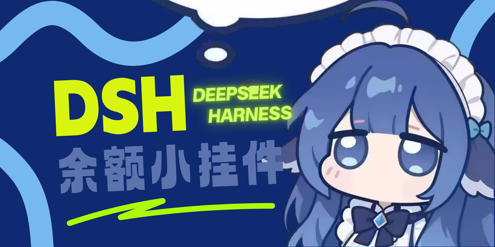

# dsh-Dfy

> DeepSeek Harness（DSH）的桌宠与挂件套件 · `v0.7.5`

小鲸鱼余额挂件 + 桌宠（106 段透明动画）+ QQ 消息卡，QQ / B站 / 双向脱敏记忆由包内自带的 SurfCore 提供。

> English: an all-in-one **DeepSeek Harness (DSH) plugin** — balance whale widget, transparent desktop pet,
> QQ message card bridged through SnowLuma, Bilibili dynamics/comments, and local redacted memory.
> One plugin for the DSH web GUI; data stays on this machine.

> **在 DSH「添加插件」里怎么填**：粘贴 `github:louke6572/dsh-Dfy`（或完整地址
> `https://github.com/louke6572/dsh-Dfy`）。**不要输入 `dsh-Dfy`** —— 那是显示名，不是包名；
> 而 npm 上的 `dsh-dfy` 是别人的包（同名不同项目），输入它只会装错。



**只有一个插件 dsh-Dfy**。以前分开安装的 `surfcore`、`surfcore-next`、`whale-widget` 已经合并进这一个包，
不需要也不应该再单独安装它们。

> 命名：界面、文档、仓库名统一写 **dsh-Dfy**；包名与目录名是全小写 `dsh-dfy`（npm / Node 的硬性要求），
> 所以命令里出现 `dsh-dfy`（安装、卸载）是正常的。

---

## 能做什么

| 能力 | 说明 |
|---|---|
| 余额与用量 | 60 秒刷新；今日已用按余额差 + 会话事件记账；每轮真实 usage 换算金额；近 7 天与按日明细 |
| 峰谷 | 状态与倒计时常驻角色左下角；节假日按谷价 |
| 小鲸鱼 | 5 套表情（133 张）、情绪 / 眨眼 / 卖萌、泡泡编辑器、音效 |
| 桌宠 | 106 段动画、13 个动作分类；Q 弹、弹簧拖拽、甩抛、屏幕漫游、分身、双击弹弓 |
| 双形态 | 小鲸鱼与桌宠可同时显示（共存），各自独立位置与大小 |
| QQ | 信封角标 + 消息 / 记录 / 写消息三视图；桥接走 SnowLuma，支持群与私聊 |
| B站 | 扫码登录、动态 / 评论互动、鱼群保护、昼夜作息 |
| 贴吧 | 手机扫码登录（自动换取并验证 BDUSS）：逛吧、发帖 / 评论 / 点赞、签到，跟 B站 共用作息 |
| 记忆 | 人格卡、双向脱敏记忆、身份对齐；数据只存本机 |

---

## 环境要求

| 项 | 要求 |
|---|---|
| 系统 | Windows 10 / 11 |
| Node.js | ≥ 22.13 |
| DSH | ≥ 0.2.1-rc.2（桌面端或 `dsh web`）；已在 0.2.2-rc.1 实测 |
| SnowLuma | 只有接 QQ 需要；Agent 安装脚本会自动从官方 Releases 装 |
| 余额 | `DEEPSEEK_API_KEY` 或 DSH「账号与余额」登录，二选一 |

不接 QQ / B站也能用：小鲸鱼与桌宠不依赖 SnowLuma。

### 兼容性（最低 DSH 版本）

- 插件在 `package.json` 的 `engines.dsh` 声明 **`>=0.2.1-rc.2`**：DSH 的插件市场与安装器会按这个范围**在安装前**拒绝过旧的 DSH，不会出现"装完才发现打不开"。
- 已在 **DSH 0.2.2-rc.1**（桌面版，Electron 44 / Node 24.21）实测通过；`dsh web` 与桌面端共用同一套宿主代码。
- 低于最低版本：先升级 DSH 再安装，不要用旧版强行解包。
- 插件加载是 fail-open 的：缺少可选服务或可选 API 时只关闭对应功能（如桌宠、B站、抖音），不会让 DSH 启动失败。

---

## 安装

四种方式选一种，**不要都做**。配置与会话状态统一写在数据目录 `$DSH_HOME/surfcore/qq/`，不写插件包目录。

### 方式一：在 DSH 里装（推荐）

DSH「插件」页 → **发现**（插件市场）搜索 **dsh-Dfy**，点安装；或在命令行装包：

```powershell
dsh plugin --profile <profile> add github:louke6572/dsh-Dfy
```

> **发现页搜不到？** 那是市场索引还没收录。本仓库自带一份索引，可以直接添加：
> 插件 → 发现 → **添加索引源**，粘贴
> `https://cdn.jsdelivr.net/gh/louke6572/dsh-Dfy@main/market/dsh-index.json`
> 之后搜索 **dsh-Dfy** 即可安装（来源是 GitHub 仓库 + 固定 commit）。
> 也可以不添加索引，直接在「添加插件」输入 `github:louke6572/dsh-Dfy`。

> 命令行装包后**还要在 DSH「插件」页把 dsh-Dfy 启用**：命令行只装包，不会登记到 profile 的
> `dsh.profile.bundles`；插件页安装会自动登记。若页面提示「构建脚本待批准」，点允许即可
> （Git 安装要跑一次 `postinstall`，修 `@snowluma/sdk` 的 ESM 打包 bug）。
>
> 命令行若报 `ERR_PNPM_IGNORED_BUILDS`：在 profile 目录运行 `pnpm approve-builds`，或在
> `<profile>/pnpm-workspace.yaml` 的 `allowBuilds` 里加 `dsh-dfy: true`，然后重跑安装。

装好启用后**完全退出 DSH**（托盘图标也要退出）再打开。首次启动会自动：

- 建数据目录 `$DSH_HOME/surfcore/qq/`（`config.json` / `state/` / `roles/` / `pet/`）；
- 从包内 `config.example.json` 生成初始配置、补齐 `roles/` 模板；
- 如果检测到旧版 clone 安装在仓库根留下的 `config.json` / `state/` / `roles/` / `pet/`，
  **只复制、不删除**到数据目录（升级不丢配置）。

QQ 功能仍需要 SnowLuma（方式二会自动装；标准安装则在设置页或运行包内 `scripts/install-snowluma.mjs` 安装）。

### 方式二：一行命令（Windows，含 SnowLuma）

```powershell
powershell -ExecutionPolicy Bypass -c "irm https://raw.githubusercontent.com/louke6572/dsh-Dfy/main/scripts/bootstrap.ps1 | iex"
```

这一条会依次完成：下载到 `%USERPROFILE%\dsh-Dfy` → `npm install`（失败自动换国内镜像）→ 写入 DSH profile
→ 安装 SnowLuma（官方 Releases）→ 生成 `config.json`。

跑完只剩**两步**，都需你亲手做：

1. **完全退出 DSH**（托盘图标也要退出），再打开；
2. 设置 → dsh-Dfy → **一键开始**；第一次用 QQ 时在 SnowLuma 窗口**扫码登录**。

可选环境变量（写在命令前面）：

| 变量 | 作用 |
|---|---|
| `$env:DSHDFY_SKIP_SNOWLUMA='1'` | 只装挂件 / 桌宠，不接 QQ |
| `$env:DSHDFY_DIR='D:\dsh-Dfy'` | 装到别的目录 |
| `$env:DSHDFY_CHECK='1'` | 只检查环境，不安装 |

### 方式三：交给 Agent

```text
帮我安装 https://github.com/louke6572/dsh-Dfy ，按仓库里的 AGENT.md 执行，需要我做的事直接说。
```

Agent 会跑同一套流程并自己处理报错；你仍然只做「重启 + 扫码」。重启必须由你做：
Agent 通常就跑在 DSH 里，它自己重启会中断当前任务。

### 方式四：手动 clone（开发 / 排查用）

```powershell
git clone --depth 1 https://github.com/louke6572/dsh-Dfy.git
cd dsh-Dfy
npm install
node scripts/setup-dsh.mjs
node scripts/install-snowluma.mjs   # 接 QQ 才需要
```

clone 安装与方式一使用**同一个数据目录**（`$DSH_HOME/surfcore/qq/`），所以两种安装可以互相切换，
配置不会分叉。

### 验证安装

```powershell
curl -s -o NUL -w "%{http_code}" http://127.0.0.1:3080/dsh-whale/widget.js
```

- `200` / `401`：插件已加载（401 是路由要求会话凭据，正常）。挂件侧共 **38 个** `/dsh-whale/*` 路由。
- 连不上：DSH 没起来或插件没挂上，看下面的「常见问题」。

浏览器 `Ctrl+F5` 后，右下角出现小鲸鱼即成功。

### 更新

- 市场 / `dsh plugin` 安装：重新执行一次 `dsh plugin --profile <profile> add github:louke6572/dsh-Dfy`；
- 一行命令安装：重跑方式二那条命令（自动 `git pull` + 依赖 + 重写 profile）。

然后重启 DSH。数据在数据目录，升级不会覆盖。

### 卸载

```powershell
dsh plugin --profile <profile> remove dsh-dfy    # 推荐
node scripts/uninstall.mjs                       # 或脚本：默认只演练
node scripts/uninstall.mjs --yes                 # 真删（保留 ~/.dsh/surfcore 里的配置 / 记忆）
node scripts/uninstall.mjs --yes --purge-state   # 连配置、记忆、日志一起删
```

---

## 第一次使用

1. **余额**：配 `DEEPSEEK_API_KEY`，或在 DSH「设置 → 账号与余额」登录；鲸鱼旁出现数字即成功。
2. **QQ（可选）**：设置页「一键开始」+ 扫码后，桥接显示「运行中」，角色旁出现信封角标；
   点信封 → 「写消息」发一条试试。
3. **B站（可选）**：控制台 → B站 → 扫码；设互动频率与鱼群保护。不接就不会请求 B站接口。
4. **记忆（可选）**：控制台 → 记忆卡，导入或新建人格卡；模板在 `roles/`、`examples/`。

---

## 日常使用

- **打开菜单**：点小鲸鱼；按钮被隐藏时，电脑端右键角色、手机端长按 1.5 秒。
- **切换形态**：菜单或控制台顶部的 `小鲸鱼` / `桌宠` / `共存`，三者互斥（共存 = 两只同时显示）。
- **QQ 消息卡**：点信封角标 → 最新消息 / 记录 / 写消息；Enter 发送，Shift + Enter 换行。
- **余额**：点鲸鱼立即刷新；气泡里看今日已用、每轮消耗、近 7 天、按日明细。
- **心情与音效**：卡片头像旁循环切换；音量在控制台「音效与提示」按四路调。
- **保存**：控制台改动点「保存配置」才生效，「恢复默认」可回退。

---

## 设置页

DSH「设置 → dsh-Dfy」与挂件内控制台是同一套配置：

| 区块 | 内容 |
|---|---|
| 状态 / 诊断 | 桥接与账号、SnowLuma 检测、一键开始、自检 |
| 呈现与位置 | 大小、吸附翻转、屏幕漫游、避让滚动条、提示气泡、峰谷显示 |
| 动作与待机（桌宠） | 13 类动作、分身数量 / 动作 / 大小 |
| 表情与台词（小鲸鱼） | 表情包、情绪映射、眨眼、台词 |
| 提示与音效 | 主音量、四路音效、消耗提示与自动关闭 |
| 角色与资源 | 导入角色、按压泡泡、图片 / 音频管理 |
| 厂商额度（选装） | 模型、凭据、火山 coding plan |
| 碎碎念与对话（桌宠） | 人设、自动碎碎念、对话与清空记忆 |
| QQ / B站 / 贴吧 / 抖音 | 桥接、群管理、B站账号与养鱼、贴吧扫码登录与心跳、抖音 IM 登录与许可会话、记忆卡、学习画像、语音触发规则 |

### 语音音源

「设置 → 语音 → 音源」六选一，语音条、卡片朗读、试听共用同一路：

| 音源 | 需要什么 | 免费情况 |
|---|---|---|
| 微软 Edge | 无 | 完全免费，免 Key |
| 豆包语音（火山引擎） | 新版：API Key；旧版：AppID + Access Token + voice_type | 21 款免费音色 + 开通送试用字符额度 |
| 阿里百炼 Qwen-TTS | API Key + 音色 + 语种 | 新人免费额度 |
| 在线免费模型（Qwen3-TTS） | 只用一句中文「声音描述」 | 完全免费、无 Key，每句约 10~30 秒 |
| 本地 voxd（8765） | 自己起 GPT-SoVITS 等 voxd 服务 | 本地免费，插件不捆绑模型 |
| 火山云端复刻（8767） | 自己起声音复刻代理 | 本地免费，插件不捆绑模型 |

> 插件不会下载任何 TTS 模型；要 Key 的两条填自己的凭证，回读时按掩码处理。
> 「在线免费模型」会把待合成文字发往 HuggingFace 的公开 Space。

### 记忆同步范围

四个平台（QQ / B站 / 贴吧 / 抖音）共用一张记忆卡：

- **全平台可见**：初次相遇、被钉住的锚点、和主人相关的身份记忆。
- **只在该通道可见**：QQ 私聊流水（受 `includeQqInBili` 控制）、桌宠私下对话（`scope='pet'` 永不进公开平台）。
- 抖音群聊按「公开场合」口径注入，只带身份记忆，避免把私聊细节带进群里。

---

## 数据与隐私

| 位置 | 用途 |
|---|---|
| `$DSH_HOME/surfcore/qq/config.json` | QQ / 桥接配置（含凭据，仅本机） |
| `$DSH_HOME/surfcore/qq/state/` | 桥接会话、记账、日志等运行状态 |
| `$DSH_HOME/surfcore/qq/roles/` | 角色卡（人格文件） |
| `$DSH_HOME/surfcore/qq/pet/` | 桌宠 host.json、QQ 消息镜像、语音数据 |
| `$DSH_HOME/surfcore/config.json` | B站 / 合体层配置（含凭据，仅本机） |
| `$DSH_HOME/surfcore/memory/` | 记忆卡与注入块（已脱敏） |
| `$DSH_HOME/surfcore/tieba/` | 贴吧登录凭据（BDUSS，0600）、心跳状态、观看记录与行为摘要 |
| `$DSH_HOME/.dshw-usage.json` | 记账账本与用量 |
| `$DSH_HOME/.dshw-bubble.json` | 泡泡序列与模块库 |
| 旧 clone 的仓库根 `config.json` / `state/` / `pet/` | 旧布局数据（迁移后只读保留，不再写入） |

> **泡泡配置文件（`$DSH_HOME/.dshw-bubble.json`）是「全量替换」语义**：文件里的 `items` 就是整条泡泡序列，
> 出厂快照只在读不到文件时兜底。照源码手写一份「最小配置」会把出厂序列整体替换掉（峰谷状态、谷价倒计时、
> choice 步骤都会一起消失，而且不报错）。想恢复默认泡泡：**删掉该文件**后刷新页面即可。

安全边界：

- 所有接口只允许回环来源，跨站请求拒绝；写请求必须来自本机。
- 凭据只发往内置端点；自定义地址需在本机面板逐个放行。
- 不下发通配 CORS，响应带 `nosniff`；仓库不含真实账号数据。
- 记忆在写入前做双向脱敏（QQ 号、手机号、证件号、长令牌等），不把原始聊天写进记忆卡。

---

## 常见问题

| 现象 | 处理 |
|---|---|
| 挂件不出现 | 确认不是用 `github:` 规格装的；按手动流程走完，再完全退出 DSH 重开 |
| `Cannot find module '@deepseek-ai/schemastery'` | 没跑 `npm install` |
| `icon exceeds 256 KiB` | 装的是旧版图标；更新到最新版 |
| 余额显示 `--` / 提示未配置 | 配 `DEEPSEEK_API_KEY`，或登录 DSH 账号 |
| 今日已用显示 `--` | 需要一次成功的余额观测，统计从那一刻开始 |
| 保存报 403 | 只允许本机用 `127.0.0.1` 操作 |
| 找不到 SnowLuma | 跑 `node scripts/install-snowluma.mjs`；仍不行就在设置页手动指定目录 |
| 信封不出现 | 桥接未运行或 SnowLuma 未登录；扫码后点「重新检测」 |
| QQ 卡片没声音 | 查卡片 🔊/🔇、全局音量、系统静音 |
| 出现两个「Agent 预设定义」 | QQ 聊天与二代仿真两条预设，正常 |
| 改了前端不生效 | `widget/assets/*` 热读取，硬刷新；改 `lib/`、`backend/`、`src/` 需重启 DSH |

---

## 开发与自检

```powershell
node build.mjs                              # lib/ui/*.js → lib/client.js（产物入库，必须重建）
node build.mjs --check                      # 只校验产物与源一致（不一致 exit 1）
node scripts/build-agent-preset-patches.mjs # dsh/agent-presets/* → presets/*.patch.yml
node scripts/build-agent-preset-patches.mjs --check

node scripts/version.mjs check              # 版本一致性（package.json / README / AGENT / CHANGELOG / tag）
node scripts/privacy-scan.mjs --strict      # 隐私闸门（本机路径 / 账号 / 令牌 / 私钥）

node widget/tools/ci-audit.mjs --no-pack    # 路由安全 / 接口对等 / 注入面 / CI
node widget/tools/ci-audit-selftest.mjs     # 审计脚本自检（防止断言空转）
node widget/tools/bubble-config-audit.mjs   # 泡泡配置「全量替换」语义回归
node widget/tools/choice-options-audit.mjs  # 并列步骤候选不被静默裁掉
node widget/tools/check-dead-settings.mjs   # 「控件有值、没有消费方」初筛
node widget/tools/expr-smoke.mjs            # 表情包清单 / 图片路由 / 配置键冒烟
node widget/tools/z-layer-audit.mjs         # 浮层层级（z-index）登记检查
```

除 `ci-audit.mjs` 完整版（会跑一次 `npm pack`）外，以上都是 0 依赖脚本，`npm install` 之前也能跑。
CI（`.github/workflows/ci.yml`）跑的就是这一组，外加全量 `node --check`。

目录：

```text
lib/       宿主与设置界面（lib/ui/* 是源码，lib/client.js 是构建产物）
backend/   SurfCore 后端：配置 / 调度 / 记账 / 更新 / 宠物 API
widget/    小鲸鱼与桌宠：lib/ 是宿主路由，assets/ 是前端单文件
src/       QQ 桥接、B站、记忆、语音、MCP
presets/   Agent 预设（由 dsh/agent-presets/* 生成）
shims/     qq-mode 转发垫片
scripts/   安装、更新、自检、发布
```

改动生效范围：

| 改了什么 | 怎样生效 |
|---|---|
| `widget/assets/*` | 浏览器硬刷新（Ctrl+F5） |
| `lib/ui/*` | 先 `node build.mjs`，再重启 DSH |
| `lib/`、`backend/`、`src/`、`shims/`、`presets/` | 重启 DSH（完全退出，含托盘） |

版本号只有一个来源：仓库根 `package.json`（README / AGENT / CHANGELOG / tag 由 `scripts/version.mjs check` 校验）。

---

## 致谢

- **[月匠 MeteorNOX](https://github.com/MeteorNOX)**：官方挂件
  [`DeepSeek-Balance-Whale-Widget`](https://github.com/MeteorNOX/DeepSeek-Balance-Whale-Widget)，
  余额 / 记账 / 峰谷 / 泡泡 / 音效与安全边界源自该项目。
- **[PC2005-cloud](https://github.com/PC2005-cloud)**：`dsh-pet`（MIT），106 段动画、动作链与桌宠物理交互源自该项目。
- **SurfCore**（[Mieksido/surfcore](https://github.com/Mieksido/surfcore)）：QQ / B站桥接、双向脱敏记忆、身份对齐。
- **SnowLuma**：第三方 QQ 运行时，负责 QQ 登录与收发消息；专有软件，不随本仓库分发，只从官方 Releases 获取。
- **DSH**：插件宿主，提供 bundle / patch / client / MCP。
- 社区贡献：Yang-huai406（Codex 迁移）、1llysviel（macOS）、0Sakura721、yybai25、Jy-EggRoll、
  VaeKaras、MengLs1620、ELFsay、ztzpro、under-the-ocean、21253soursweetlemon、fangbm、xiaolinnnnnnn。

---

## 许可证

代码基于 **MIT License**，见 [LICENSE](LICENSE)。`widget/assets/` 与 `assets/` 下的美术素材不在 MIT 覆盖范围内，
按「原样」分发，来源与权利主张见 [PROVENANCE.md](PROVENANCE.md)。
