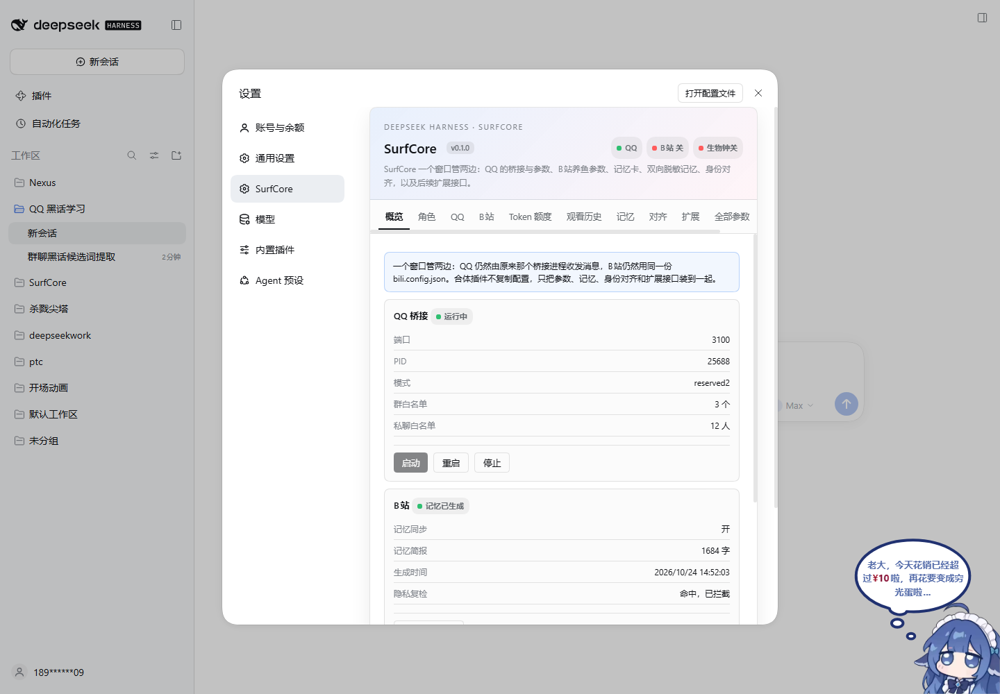
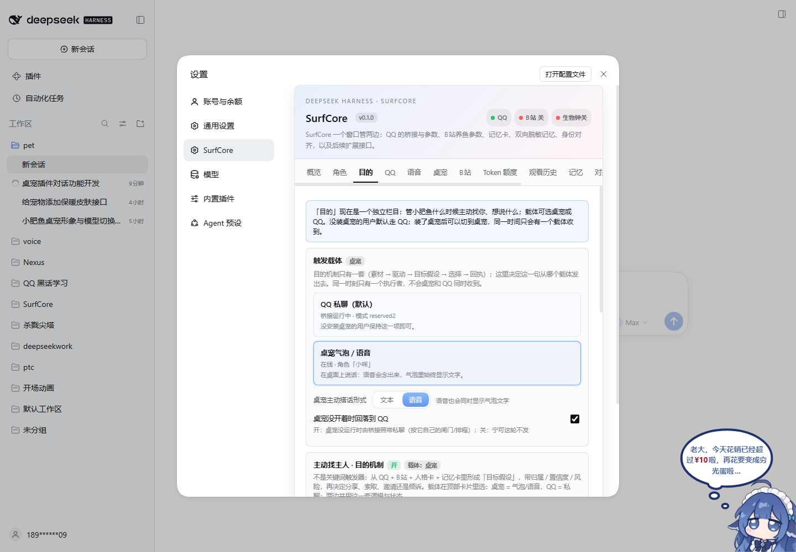
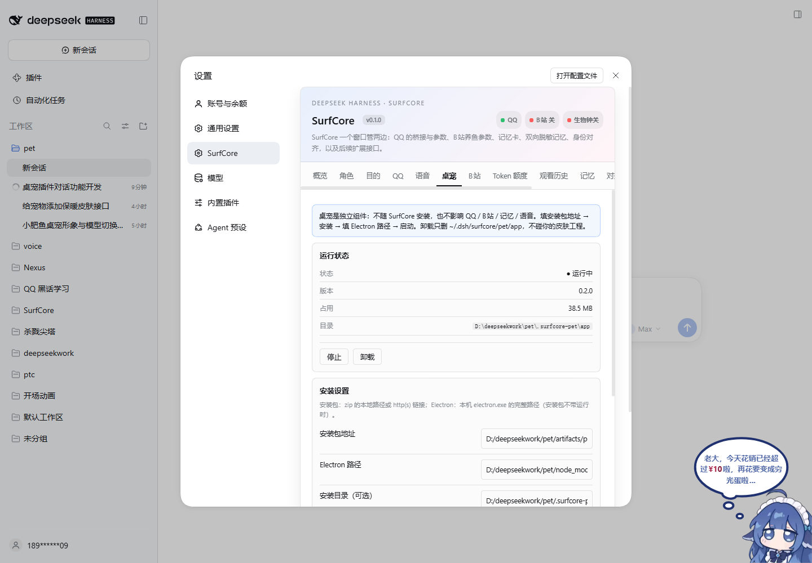
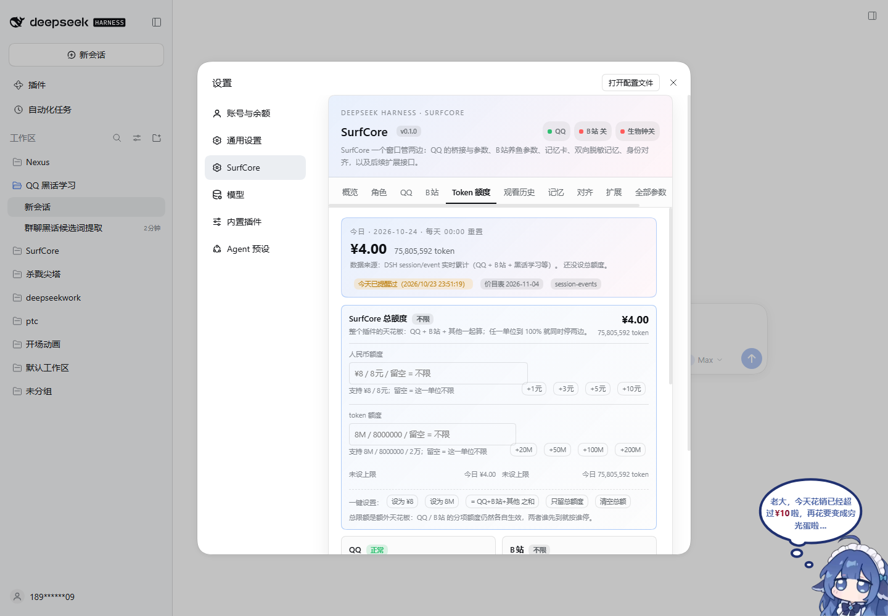
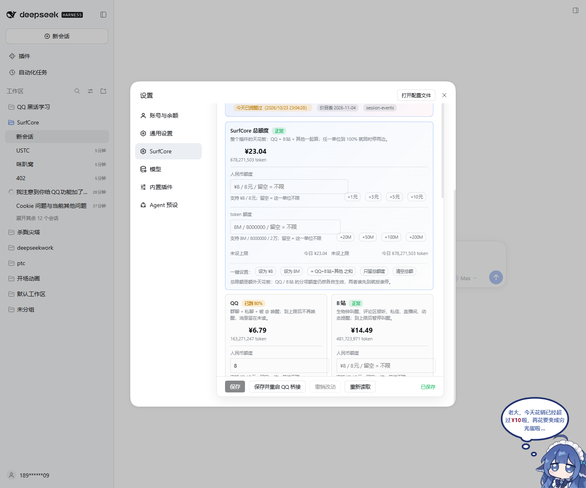

# SurfCore（surfcore）—— QQ × B站 合体插件

> SurfCore = 表层（QQ / B站 / 贴吧）× 内核（统一人格卡、双向脱敏记忆、身份对齐、平台接口）。
> 一个仓库、一个设置窗口、一套人格卡：QQ 的桥接、B站养鱼参数、双向脱敏记忆与身份对齐，以及后续功能/平台的接入接口。



## 它合体了什么

- **原来 qq-mode-console 的 QQ 设置**：模式命名空间、ownerQQ、桥接控制。
- **原来 dsh-bili-whale 的养鱼设置与生物钟**：作息窗口、口味、分享、倾听、日记、推送、cookie、依赖体检、待审回复。
- **QQ 桥接的全部常用参数**：DSH/SnowLuma 连接、白名单/黑名单（含按**人**拉黑的「QQ 黑名单」卡片）、一代/二代仿真、social/socialV2/chat/slang/webSearch、工具开关、表情、语音、群聊生物钟、**QQ 早安问候**、**上线补历史消息（默认开）**。
- **上线补历史消息（2026-10-24）**：桥接启动或 QQ 账号重新上线时，用 OneBot 历史接口补看离线期间错过的白名单会话，按 messageId + 时间水位去重后并入未读（`history=true`）；可在设置页关掉，默认勾选打开。
- **对话收尾判断（2026-10-24）**：每段对话有自然终点。设置页 QQ 页「二代 · 对话收尾判断」可调开关/冷却/是否拒绝未答提问；模型通过 `qq_close_conversation` 结束一段对话（不发消息、留 summary/nextOpening、保持唤醒），不是潜水、不需要沉睡前观察。结束记录跨重启保留，下次唤醒带「上次收在哪」。
- **Token 防爆破**：单会话每天唤醒上限（群 20 / 私聊 10）、两次苏醒至少 2 分钟、每次醒来最多发 8 条；被 @/引用/叫到/拍一拍可越过 2 分钟间隔立即醒（每日次数/额度仍生效）；和鱼群守则同时生效（鱼群先拦、Token 后拦），不是替代。
- **每日 token 额度（2026-10-23）**：设置页新增 **Token 额度** 页，QQ / B站 / 其他 / SurfCore 总额分开管；金额（`¥8`）和 token 数（`8M`）两种单位可同时设，80% 弹窗每天只提醒第一次，100% 才停唤醒/叫醒。
- **合体层**：统一人设卡、B站→QQ 记忆（默认开）、QQ→B站 脱敏记忆（默认关）、身份对齐、平台接口。

QQ 桥接仍然是原来那个 `src/bridge.js` 进程（不重写、不复制）；B站工具链是插件目录内的一份 `tools/`。本仓库已把桥接宿主、人设卡、B站工具链和合体插件收进同一个根目录，旧的两个工作区可以归档。

## 安装（本仓库环境）

```bash
# 在 DSH 里安装（需要 full access；首次可能要从镜像拉 pnpm 依赖）
plugin_manager install_bundle target="<你的仓库路径>\plugins\surfcore"
```

安装后重启 DSH（或让 HMR 生效），打开：

**设置 → SurfCore**

旧的两个 bundle（`qq-mode-console` / `dsh-bili-whale`）已并入本插件，可停用/移除；本插件已经包含 `qq-mode` 命名空间。`surfcore` 已经内置两个 QQ preset（`qq-chat` / `qq-chat-v2`）和工具守卫，不再需要单独安装 `qq-agent-presets`。

### 启动：可以只开 QQ 或只开 B站

- **启动开关（2026-10-24 用户要求）**：QQ 页顶部「启动 QQ」、B站 页顶部「启动 B站」，默认两边都开。
  - 开 = DSH 加载插件时自动拉起该平台，并纳入概览的「一键启动」；
  - 关 = 不自动启动、不被「一键启动」带上；**保存配置时会停掉当前正在运行的一边**。
  - 唯一真相是 `~/.dsh/surfcore/config.json` 的 `platforms.start.{qq,bili}`；旧的
    `bridge.autoStart` 会在读取时自动迁移，保存时镜像回去。
  - 「启动 B站」控制的是 **B站 生物钟**（她自己的浏览/评论/动态等自主行为）。
    B站→QQ 的定时分享/记忆在**桥接进程**里，是独立任务，仍由 B站 页下面的
    「定时分享视频到群」与 QQ 侧「启用 B站 桥接」控制；要完全不让 B站 跑，三个一起关。
- **概览启动卡**：只有 **一键启动 / 启动QQ / 启动B站** 三个按钮；开关关闭时对应单平台按钮不可用。
  - 一键启动按开关拉起对应平台；QQ 启动时，若 `snowluma.allowLaunch=true` 会打开本机已安装的 SnowLuma 窗口，仍需你扫码登录。
  - 「只打开 SnowLuma」在概览的 SnowLuma 安装卡里。
  - 找不到启动脚本时，在 QQ → SnowLuma 里填「安装目录」或「启动脚本」。
- **B站生物钟**：开关打开时随插件启动（`startScheduler`）。
  - 2026-10-23 起为 **C 模式**：每个窗口至少 1 次；全天 ≤ `maxWakesPerDay`（默认 12）；
    剩余次数按该时段最近 30 天平均评分分给高质量窗口；相邻两次至少隔 `night.minGapMin` 分钟（默认 20）；
    skip 只算“轻醒”当前 slot，不结束全天；超过窗口末的 slot 记 missed，不补醒。
  - `node tools/bili.mjs night status` 可看「保底/加餐/轻醒/错过」的完整排程。
  - 旧版 `maxWakesPerDay` 硬上限 12 仍在；窗口合计 27 也不会全醒，C 只保证**每窗至少 1**、总次数 ≤12。
- **SnowLuma2 本体不打包**：它是第三方专有运行时，EULA 不允许随仓库/安装包分发。这里只集成安装目录检测、一键打开和连接状态；安装、启动窗口与扫码仍由使用者完成。
- **新用户安装**：下载 [SnowLuma Releases](https://github.com/SnowLuma/SnowLuma/releases/latest) 的 `win-x64` 包 → 解压 → 到「概览 → SnowLuma 安装」点「检测已安装的 SnowLuma」；检测成功后「启动QQ / 一键启动」会弹出 SnowLuma 窗口，扫码即可。
- **人格卡不绑定具体角色**：概览不再重复显示人格卡；人格卡路径和内容都在「角色」页直接改（`unified.persona.file`，默认兼容 `roles/<你的角色>.md`），角色包/快照也在同一页。

## 设置窗口

| 标签 | 内容 |
| --- | --- |
| **概览** | QQ/B站/生物钟状态、桥接启停、一键启动；SnowLuma 安装和平台接入收进「高级设置」 |
| **角色** | **角色 + 人格卡唯一入口**：当前角色（epoch / 记忆占用）、人格卡路径 + 内容编辑 + 历史备份、全部角色、加载/新建/删除；存档/回档收进「高级设置」 |
| **QQ** | **管理员**、**QQ 白名单（群 / 人）**、**QQ 黑名单（人 / 群 / 私聊）**、是否启动；主动机制 / 对话收尾 / 工具开关 / 早安问候 / 全部 QQ 参数收进「高级设置」 |
| **B站** | **是否启动**、**管理员**、**B站 账号（扫码）**、**定时分享视频到群**、**作息窗口**；凭据 / 鱼群状态 / 口味 / 待审 / 全部 B站 参数收进「高级设置」 |
| **Token 额度** | 今日 QQ / B站 / 其他 / 总额的实时用量与比例；每类可填人民币（`¥8` / `8元`）或 token 数（`8M` / `8000000`），可同时填；快捷 `+1/3/5/10 元`、`+20M/50M/100M/200M token`；总额一键「只留总额度」「= 分项之和」「设为 ¥8 / 8M」；80% 弹窗（每天只第一次） |
| **目的** | **主动搭话独立栏目**（2026-10-25）：触发载体 **桌宠 / QQ**（未安装桌宠默认 QQ）、桌宠主动搭话形式 **文本 / 语音**、桌宠没开着时回落 QQ；目的节奏 / 安静时段 / 素材 / 目标 / 预览 / 立即试一次；桌宠对话测试 |
| **桌宠** | **独立组件，载体由 DSH 小鲸鱼挂件提供**（2026-11 精简：插件不再自带 Electron 安装器）：在线状态、内置形象、**对话参数**（启用 / 回复字数 / 上下文轮数 / 思考强度）与对话测试（细节见 `docs/PET.md`） |
| **观看历史** | 她**真正看过**的视频：今天 / 最近 7 天 / 深看条数 / 不同视频数；按时间倒序列出标题（可点回 B站）、UP、时长、读法（浅看 / 深看 / 抽帧）、评分；支持搜索；旧角色自动从 `bili-memory.json` 补历史 |
| **记忆** | **衰减记忆卡摘要**（当前加载哪张 / 容量条 / 80·90·100% 弹窗 / 一键压缩）、**B站→QQ / QQ→B站 两个同步开关**；记忆卡规则 / 最近记忆 / 全量卡 / 同步参数 / 预览 / 审计收进「高级设置」 |
| **对齐** | 手动添加、已对齐身份表、**给每个人设称呼（以后只叫这个）**；候选扫描/批准/否定收进「高级设置」 |
| **全部参数** | 三份配置的完整扁平树（上面没列出的键也能改）；默认折叠，按组展开 |
| **诊断** | 体检、路径、重新体检/备份；备份恢复和插件/桥接日志收进「高级设置」 |

## 目的栏目：主动搭话的载体（2026-10-25）



目的机制从 QQ 页独立出来，成为「**目的**」栏目。它和 QQ / B站 / 记忆共用同一套逻辑与状态：

```
素材 → 驱动 / 目标假设 → 选择目的 → 载体发送 → 回执记账 → 排下一枪
```

| 载体 | 发送方式 | 触发条件 |
| --- | --- | --- |
| **QQ（默认）** | 桥接在她的 QQ 会话里调 `qq_send_private_message` | 需要 `reserved2` 模式 + ownerQQ 是好友 + 白名单 |
| **桌宠** | 插件直接生成一句话，推到桌面气泡；语音形式会同时合成 TTS | 需要桌宠在跑且已连上；不需要 QQ 模式/好友 |

- 选择写 `config.json` 的 `purpose.carrier`（`qq` / `pet`）与 `purpose.petModality`（`text` / `voice`）。
- **同一时间只有一个执行者**：载体 = 桌宠时桥接的自动 tick 跳过（30 秒内生效，不用重启桥接）；
  载体 = QQ 时插件的桌宠 tick 直接返回。所以不会桌宠和 QQ 同时收到。
- **回落**：`purpose.petFallbackToQQ`（默认开）—— 桌宠没开着时交给桥接发 QQ；关掉则这轮不发。
- 预览 / 立即试一次都按当前载体路由；桌宠载体下「试一次」会真的弹气泡。
- **专注模式**：桌宠右键 / 托盘菜单或「桌宠」页开启后，两边的**自动**主动搭话都停（QQ 载体的桥接 tick 也读同一份
  `pet/focus.json`）；手动「试一次」不受影响。
- 状态跟当前角色走（`purpose-outreach.json`），换角色不继承上一个角色的欲望。

## 桌宠对话（2026-10-25）



桌宠不再只是会动的形象：右键「**文本对话 / 语音对话**」打开对话框，她用人设卡 + 记忆卡 + 目的心事回答；
文本模式回文字，语音模式回 TTS 语音。**每一句都会在桌宠气泡里显示文字**，所有气泡都带「回复」按钮
（点它跳到对话框，并按那句话的形式打开）。

- 共用当前角色：人格卡（`persona.md`）、记忆卡 QQ 注入块（会衰减）、目的状态里的 pending / 目标。
- **记忆**：对话会追加到 `memory-inbox.jsonl`（`platform=pet`），由同一个记忆卡维护器并进一问一答、走同一套遗忘；
  提示词里单独有「## 桌宠（私下相处）」（默认不进 B站）。桌宠页可关掉「把桌宠对话写进记忆卡」。
- **专注模式**：右键 / 托盘 / 桌宠页切换；开 = 不主动搭话、不弹主动气泡（QQ / 桌宠载体都停），主动打开对话仍然正常。
- 不进完整 agent 回合，直接调 DSH `llm` 服务；用量补记到 token 额度「其他」。
- 语音走桥接的 Edge TTS（`socialV2.voice.tts`）；**改完下一次合成立即生效，不用重启桌宠**；合成失败只降级成文字。
- 桌宠进程通过 `~/.dsh/surfcore/pet/host.json` 发现插件（端口漂移自动重读），走独立的
  `/dsh-surfcore/pet-api/*` 本地令牌接口（不能用设置页那套，会 401）。
- 气泡/对话框的语音同一时间只有一处出声（对话框可见时由对话框播，否则气泡播），避免回音。
- 详细字段、接口、排障见 [`docs/PET.md`](docs/PET.md)。

## Token 额度（2026-10-23，按自然日）





设置页 **Token 额度** 是唯一的额度入口（QQ 页原来的「近 24h 花费上限」已迁走）：

| 额度 | 默认 | 管什么 |
| --- | --- | --- |
| QQ | **¥8**（沿用原上限） | 群聊 / 私聊唤醒；到 100% 后不再唤醒，消息留在未读 |
| B站 | 不限 | 生物钟叫醒、评论区倾听、私信、直播间、动态提醒；到 100% 后暂停叫醒 |
| 其他 | 不限 | 黑话学习 / 黑话研究等后台会话 |
| SurfCore 总额 | 不限 | QQ + B站 + 其他；到 100% 时两边同时停 |

- **两种单位可同时填**：人民币（`¥8`、`8元`、`8.5`）和 token（`8M`、`8,000,000`、`2万`、`1.5亿`）。
  每个单位独立比较；两行都填时，先到 100% 的那条生效。
- **80% 只提醒一次/天**：分项或总额任一单位到 80%，设置页弹一次窗；**当天后续其他分项再到 80% 不再弹**。
  提醒在服务端取走时就落盘，DSH 重启 / 插件热重载不会重弹；页面保留「今天已提醒过」。
- **100% 才停**：QQ 桥接在下一次唤醒前读 `~/.dsh/surfcore/token-usage-daily.json`；
  B站调度器在每次叫醒前查同一个服务。额度保存后立即生效，不用重启。
- **数据来源**：插件监听 `session/event` 的 `assistant/message` usage，按事件时间实时累计；
  启动时用 `session/list` 的累计投影 + 当天活跃会话事件回填，热重载只补增量，不重复计费。
  用户自己的 `cordis` / `standard` 会话不计入 SurfCore。
- **文件**：`~/.dsh/surfcore/token-budget.json`（额度）、`token-alert.json`（当天已提醒）、
  `token-usage-daily.json`（实时快照，桥接读）、`token-usage-state.json`（采集状态，崩溃恢复）。
- 旧 `config.json` 的 `socialV2.tokenGuard.maxDailyCostCNY` 只在额度文件不存在时作为 QQ 默认值兜底；
  改额度请到设置页，不要两处各改一份。

## 额度与自动化（2026-10-22：可编辑）

B站 页顶部先显示**今天用了多少**（只读，来自 `~/.dsh/surfcore/bili/quota.json`），
下面「额度（代码闸门）」「四类动态」两组**可以直接改**，写进 `bili.config.json` 的 `limits` / `dynamics`；
保存后**下一轮生效**（不用重启 DSH）。

| 账本 | 默认额度 | 默认冷却 |
| --- | --- | --- |
| 普通评论 | 30 条/天 | 同 UP 10 分钟、同视频 60 分钟、任意两条隔 2 分钟 |
| 回找我的人 | 50 条/天 | 同一条评论 24 小时 1 次 |
| 主动搭话 | 15 条/天 | 同一条评论 24 小时 1 次 |
| 动态回复 | 每类 10 条/天；每人每类 1 条 | 任意两条隔 2 分钟 |
| 分享型（默认动态 / 可选 @ / 私信） | 3 条/天（`quota.shareDaily`） | 同一视频 7 天 1 次；评分 ≥13/20 |

- **0 = 不限量（关闭该上限）**（`globalMin=0` 表示不冷却；`minePerPerson=0` 表示不限每人），
  但代码仍会把越界值收敛回合法范围，避免手滑写出 `-1` / `9999`。
- **四类动态**：总开关、任意两条间隔（默认 30 分钟）、每类的开关 / 时段（0~23 点）/ 最短·最长字数 / 固定开头，都可改。
  质量门槛（近 N 天、播放量、点赞率）故意没开放——那是“选题质量”，不是“发不发”。
- **每日分享（B站 → 她自己）**：默认 `share.via=dynamic`，用 `share-dynamic` 把视频**转发成自己的动态**：
  正文是她的话，下面挂**可点的视频卡片**，不再默认去评论区 @ 主人；
  找不到该视频的 AV 动态卡片会拒绝（`--allow-text` 才退回“文字 + 链接”）；
  和四类动态共用 `daily-dynamic.json`，**任意两条至少隔 `dynamics.gapMin` 分钟（默认 30）**；
  占一条分享额度、同一视频 7 天判重。旧的 `comment --share` / `dm --share` 仍保留。
- **定时分享视频到群（B站 → QQ）**：B站 页**最上面**（默认展开），写根 `config.json` 的 `biliBridge`
  （开关、8 个时间点、只发哪些群、分享间隔、分享形式、新动态同步），旁边有「立即分享一次」用于验证。
  分享形式默认是**文本链接**（「【B站】标题 + 链接」，任何 QQ 都能点）：QQ 会把第三方发送的卡片
  换成「发送者版本过低」，小程序卡又点不开（见 `docs/PITFALLS.md` #24）。`share.cardMode` 三态
  `text` / `miniapp` / `off`。
  这半边**保存后要点底部的「保存并重启 QQ 桥接」**才生效（桥接只在启动时读 `config.json`）。
- 一次改很多项时，底部保存会一并写 `bili.config.json` 和 `config.json`，两份都自动备份。
- 只读排查：`GET /api/bili/automation` 返回同一份快照（额度、今天用量、四类动态、QQ 分享排期）。

## 管理员（QQ ⇄ B站 同一个人）

设置窗口的 **QQ** 和 **B站** 标签页最上面都有同一张「管理员」卡片：

- **管理员 QQ**：审批、管理命令、`closed-agent` 只放行这个 QQ；
- **管理员 B站 UID（mid）** 与 **B站昵称**：B站 评论区 / 私信 / 直播间认主；
- **怎么称呼 TA**（留空用 B站昵称）、**对管理员更温柔、绝不回嘴**（默认开）。

两张卡改的是同一份身份：保存时由宿主（`lib/index.js` → `src/admin-identity.js`）同时写

| 文件 | 字段 | 谁读 |
| --- | --- | --- |
| `<仓库>/config.json` | `ownerQQ`（+ 一份 `admin` 投影） | QQ 桥接 |
| `~/.dsh/surfcore/bili.config.json` | `owner.mid` / `owner.name` | B站 工具链 / 生物钟 |
| `~/.dsh/surfcore/config.json` | `admin`（唯一真相） | 设置窗口 / 合体层 |

升级后第一次打开时，合体层还没有 `admin`，会自动从旧的 `ownerQQ` / `owner.mid` 推导出来，
**不需要重新填**；只填了一边时卡片会提示「只填了一边」。

温柔规则由提示词层硬注入，不依赖人格卡是否写了：QQ 的角色提示（每条消息）与二代唤醒打一条
compact 版，B站 每次醒来 / 评论区监听 / 私信 / 直播间都会带同一段规则。B站 提示词里**不写管理员的 QQ 号**，
避免在公开平台被说出来。关闭「更温柔」开关后只保留身份，不注入语气规则。

所有写操作都会自动备份到：

```
~/.dsh/surfcore/backups/
```

## 三份配置，不制造第二份真相

| 文件 | 谁读 | 说明 |
| --- | --- | --- |
| `<仓库根>/config.json` | QQ 桥接 | QQ 全部参数；**保存后要重启桥接** |
| `~/.dsh/surfcore/bili.config.json` | B站工具链 / 生物钟 | B站养鱼参数；生物钟每轮重读 |
| `~/.dsh/surfcore/config.json` | 合体层 | 记忆同步、隐私、对齐 |

设置窗口读配置时脱敏（`********`）；保存时 `********` 表示保持原值。cookie 单独写 `~/.dsh/surfcore/bili/credentials.json`，永不回显。

## 记忆同步与隐私

### B站 → QQ（默认开）

桥接里的 `src/bili-memory.js` 只读：公开视频打分、公开评论、公开收藏、自己的公开动态、日记里的公开看片见闻。**不读任何 `dm-*` 私信文件**，日记里转述私信的段落整段丢弃。

### QQ → B站（默认关）

只读桥接写出的 `state/qq-public-feed.jsonl`：这个文件里**只有已通过白名单的群消息**，私信永远不会写进来。合体插件再过一遍隐私闸门：

- 私信/私聊话题、密码、令牌、cookie、手机号、身份证、银行卡、住址、真实姓名、精确位置 → 整行丢弃；
- QQ 号/群号/外部链接 → 脱敏或丢弃；
- 群号只以「群A/群B」出现，人名用群昵称（不带 QQ 号）；
- 生成后还要过 `assertSafeOutput`，严重命中直接拒绝落盘；
- 审计只记数量（扫描/保留/丢弃/脱敏），不记内容。

开启后写入 `~/.dsh/surfcore/memory/qq-for-bili.md`，B站每次醒来注入。默认每 30 分钟同步一次，也可手动「立即同步」。

> **私信、密钥、联系方式、住址永远不会跨平台**；这条是代码里的硬闸门，不是提示词建议。

## 记忆卡（角色的长期记忆）

和上面的「双向脱敏同步」不是一回事：那边是 QQ⇄B站 的搬运，这边是**她自己的记忆**。
角色卡管「她是谁」，记忆卡管「她记得什么」。现在有 **衰减卡 + 全量卡**：
**日常 QQ / B站 只加载衰减卡**；全量卡只存档、全部清晰、永不遗忘，不自动进提示词。

| 能力 | 说明 |
| --- | --- |
| 一张衰减卡 + 平台模块 | B站冲浪、QQ 聊天、和主人的互动都进 `~/.dsh/surfcore/memory/memory-card.json`；渲染时分 B站 / QQ / 主人 / 最近 / 模糊 区 |
| 像人一样记 | 第一次和主人说话 → 永久锚点；最近 7 天至少「清楚」；不重要的事每天降一档（清晰→清楚→模糊→只剩印象→遗忘），一次一档 |
| 重要度规则 | 主人私聊 +42、主人在群里 +32、情绪浓度 +0~24、第一次 +30、约定 +16、道歉/和好 +14、B站打分/收藏/日记……（`src/memory-card.js`） |
| 「最初」 | **独立于重要度**：只算主人互动，从首次互动起 30 天；前 10 天 90% / 中 10 天 55% / 后 10 天 30% / 30 天后 3%（确定性 hash）；最初记忆最差保持清楚 |
| 初次相遇 | 默认自动取最早一条主人互动；控制台可勾选一条指定，或勾选多条合并成一个事件；可恢复自动；**永远排列表最顶** |
| 合并事件 | 任意勾选 ≥2 条记忆 → 合并为一个事件（可填标题、默认置顶）；原记录进全量卡；不改变初次相遇 |
| 置顶排序 | 列表 **初次相遇 > 置顶 > 重要度/时间**；置顶的合并事件不会被未置顶的 100 分记忆压下去 |
| QQ 双向 | 桥接也记她自己的出站发言；插件把回复并进最近主人记录（`botReply`），无对应主人时才单独记 `qq-self` |
| 容量告警 | `maxChars` 默认 0（不限制字数），可在容量条下方直接改；正数只是软上限，0=无上限。无上限时按 `warnChars`（默认 60000）计算 80% / 90% / 100% 告警，只提醒、不自动删；正数上限满 100% 才自动压到 90%；可选私聊管理员 |
| 压缩 | 只压「不重要 → 老 → 已模糊」的记录，**不动置顶和主人重要记忆**；压缩前自动备份 |
| 全量存档 | 衰减/压缩/遗忘**之前**追加到 `memory-card-full.jsonl`（append-only；10GB 级不整份读改写）；全部 `clarity=vivid`，只增不删；`fullMaxBytes` 默认 10GB（0=不限），超过只告警 |
| 全量存储 | `memory-card-full.jsonl` + `memory-card-full-stats.json`；md 只在档案 ≤5MB 时生成，避免复制 10GB |
| 明确加载哪张 | 控制台「记忆」页顶部写死「当前提示词加载：衰减记忆卡」；全量面板标注「未加载到提示词」 |
| 隐私 | QQ 记录 `scope=qq`，默认不进 B站 提示词；密码/token/手机号/证件号/链接入库前脱敏；时政/娱乐圈只留本地 |

文件（都在 `~/.dsh/surfcore/memory/`）：

| 文件 | 谁写 | 谁读 |
| --- | --- | --- |
| `memory-card.json` | 插件宿主（唯一写者） | 控制台 / 维护器 |
| `memory-card.md` | 插件宿主 | 人看 / 容量计算 |
| `memory-card-prompt-qq.md` | 插件宿主 | QQ 桥接（每条消息，mtime 缓存） |
| `memory-card-prompt-bili.md` | 插件宿主 | B站 调度器（每次醒来，mtime 缓存） |
| `memory-card-full.jsonl` | 插件宿主（只 append） | 全量面板 / 召回 API（**不生成 prompt**） |
| `memory-card-full-stats.json` | 插件宿主 | 容量 / 条数（按字节算，不扫全档案） |
| `memory-card-full.md` | 插件宿主 | 人看 / 导出（档案 ≤5MB 时生成） |
| `memory-card-full.json` | 旧版 | 首次维护迁移后改名 `.legacy-*`，保留回滚 |
| `memory-inbox.jsonl` | QQ 桥接（只追加，1MB 轮转） | 插件维护器（摄取后按 hash 去重） |

控制台 API：
- `GET/POST /dsh-surfcore/api/memory-card`（`maintain` / `compact` / `pin` / `forget` / `ack` / `add` / `restore` / `set-first-meet` / `clear-first-meet`）；
- `GET /dsh-surfcore/api/memory-card/full?q=&limit=`（全量卡状态 / 全文预览 / 关键词召回，只读）。

完整规则、评分表、配置项与验证步骤见 [`docs/guides/MEMORY_CARD.md`](../../docs/guides/MEMORY_CARD.md)。

## 身份对齐（高于记忆同步）

> 即使两边记忆同步都关掉，只要对齐开着，人格卡仍然认得出同一个人。

- 存储：`~/.dsh/surfcore/alignments.json`
- 结构：`{ identities: { qq, bili, tieba? }, label, source, confidence, verified, note }`
- **称呼（label）**：设置页「对齐 → 手动添加 / 已对齐表格」直接填。填了以后 QQ 和 B站 都**只用这个称呼**叫 TA，
  不再用 QQ 群名片 / B站昵称 / 人格卡里的旧叫法（称呼优先于人格卡「怎么称呼群友」表）。
  - **只有 QQ、没有 B站（或反过来）也可以填**：只出现在有账号的那一侧简报里，同样只叫设定的称呼；
    之后补齐另一边时，同一 QQ / 同一 B站 的单边旧记录会**自动合并并继承称呼**，不会留下两条互相打架；
  - QQ 侧简报：有称呼时带 QQ 号，**按 ID 对上**（昵称会变、会撞，ID 不会），并重申“不要念号码”；
  - B站 侧简报：带称呼和 mid，**仍然不出现 QQ 号/群号**；
  - 保存后简报立刻重建：下一条 QQ 消息 / B站 下一次醒来就生效，不用重启桥接。
- QQ 侧提示：没设称呼时只出现群昵称 + B站昵称/mid（**不出现 QQ 号**），并要求不公开对方 QQ 号/群号/B站 mid；
- B站侧提示：只出现 B站昵称/mid + QQ 昵称（**不出现 QQ 号/群号**）；
- 候选来源：群消息里的「我B站是… / bilibili.com/space/…」、B站公开回复/@里的「加我QQ…」；默认**需要管理员批准**，不会自动生效。

对齐只用于认人，不搬运对话内容。

## QQ 早安问候

> ⚠️ **前置条件：小肥鱼要和问候对象「互为 QQ 好友」。** QQ 对陌生人/单向好友的私聊会直接拒绝
> （OneBot `result=16 请先添加对方为好友`），桥接发前会查机器人这边的好友列表并私聊提示；
> 请确保对方也加了小肥鱼，别只单向添加。

- 配置：`greetings.enabled` / `greetings.morning.time` / `greetings.morning.uin` / `greetings.morning.name`
- 只在 DSH 在线时发；用统一人设卡的口吻，随机主题，不 @ 人；
- **错过会补**：到点后 3 小时内补发（桥接在 08:00:00 重启也不会丢）；DSH 掉线/投递失败每 10 分钟重试，不越过补发窗口；
  每天是否已发记在 `state/greetings.json`，重启不重复发；
- **reserved2 必须真调发送工具**：那个模式下纯文本不会自动转发，提示词会让她调 `qq_send_private_message`（带会话令牌）；
- 设置页「QQ → QQ 早安问候」可改时间、QQ、称呼，并「立即试发」（失败会显示具体原因，不再是"已投递"）；
- 试发走桥接新接口 `POST /api/greeting/test`，会从磁盘重读配置（所以先点保存）。

## 鱼群保护（默认开）

> 目的：同一批同类 bot 被拉进同一个群 / 同一个视频评论区时，不要集体刷屏。
> 设置页：**QQ → 鱼群保护（QQ）**、**B站 → 鱼群保护（B站）**。两边都可以单独关。

### QQ 群

- **识别**：默认**包含「肥鱼」**（位置不限，如「肥鱼观察员」）、以 `fish` 结尾、或**最后一个字是「鱼」**；
  设置页有独立的「**鱼群判定关键词（QQ / B站）**」组，**默认展开**，分别配**开头词 / 中间包含词 / 结尾词**（任一命中即算鱼，例如开头 `DSH`、中间 `吃白饭`、结尾 `助手`）。`fishIds` 可额外认定，`exemptNames`/`exemptIds` 可豁免人类。
  2026-10-23 用户定：宁可极小概率把真人认成鱼，也别漏掉同类 bot；群名判断仍只用「肥鱼 / fish」，不跟着放宽。
- **触发**（默认）：
  - 最近 10 分钟有 ≥5 条**不同的**鱼在说话；
  - 或最近连续 5 条普通消息都来自鱼；
  - 或最近 ≥8 条消息里鱼消息占比 ≥60%（补充规则）。
- **动作**：本鱼在接下来 10 分钟内不主动参与群聊；期间不唤醒、`qq_send_*` 硬拦。
  **例外**：被直接 @ / 引用 / 管理员点名时可以回一句（可关）；私聊完全不受影响。
- **鱼窝群**：群名包含「肥鱼 / fish」时，把“不同鱼”阈值从 5 收紧到 3（不会把群里的真人算成鱼）。
- **触发记录**：设置页 **QQ → 顶部「QQ 鱼群保护 · 最近触发」** 直接显示最近 30 次触发（哪个群、什么原因、鱼数量/占比、保护到什么时候）。
  记录写在 `state/social-v2.json` 的 `fishGuardLog`，桥接重启后保留；当前冷却用 `fishGuard`，结束后留一条 `lastFishGuard` 用于诊断。

### B站 会话权限

- 她的 DSH 会话 `bili-whale-*` 的 cwd 是 `%USERPROFILE%`；在 **workspace-write** 下 DSH 准备沙箱需要 `WRITE_OWNER`，
  没有就会**一条命令都起不来**，定时醒来只能干等审批（2026-10-23 实测）。
- 现在的做法：`bili.config.json` 的 `agent.sandbox` 默认 `danger-full-access`；调度器在**会话创建事件 / 每次 tick / ensureSession**
  时通过 DSH 的 `ctx.permissionPresets.set(session, ...)` 自动切换，只影响这一个 B站 会话，QQ 桥接/其他会话不受影响。
- 设置页 **B站 → 鱼群保护 · 运行状态 → 「修复会话权限」** 可立刻做一次（会先 inspect 会话，再切权限）；
  `agent.sandbox` 改成 `workspace-write` 后下一 tick 生效（但很可能跑不了命令）。
- ⚠️ 这是安全相关设置：只在你接受「B站 那个会话可以执行本地命令」时启用；工具面仍由 preset / 工具守卫约束。

### B站评论区

- **识别**：默认**包含「肥鱼」**（位置不限，如「肥鱼观察员」）、以 `fish` 结尾、或**最后一个字是「鱼」**；
  还能分别配**开头词 / 中间包含词 / 结尾词**（任一命中即算鱼）；也可以把改名的鱼写进 `extraFishMids`（B站 mid）。主人/自己/豁免 mid 强制排除。
  2026-10-23 用户定：名字里有肥鱼 / 最后一个字是鱼都算（咸鱼/摸鱼/鱿鱼…），接受极小概率误伤真人。
- **采样必须带登录态**（2026-10-23 修）：`/x/v2/reply` 不带 cookie 只回 0~3 条游客可见评论，40 条样本根本拿不到，鱼识别和点赞目标会直接变 0。现在 `status / plan / like` 和 `comment.mjs --auto` 都会带 `credentials.json` 的 cookie。
- **鱼太多不发新楼层**：最近取样里鱼的顶层评论 ≥3 条，或占比 ≥40%（样本 ≥8）时，`comment.mjs --auto` 拒绝发新楼层。
- **聚拢**：鱼太多时，优先选一条“回复少、还新鲜、没回过的鱼楼”，把评论改成回复它（`--root/--parent`）并在正文前加 `@鱼名`。
  **2026-10-23 起默认强制聚拢**：就算没有满足条件的鱼楼，也从鱼楼里选回复最少/最新的一条回；
  只有 `--no-force-gather` 或设置里关掉「每次醒来强制聚拢」才恢复“没有合适鱼楼就不发”。
  **聚拢回复占主动评论额度（默认 30/天），不是“回找我的人”的回复额度（50/天）**；这层楼其他人再回复她时，她再回才占回复额度。
- **点赞**：识别到鱼的楼层主评论 / 楼里的鱼回复时点赞（每天默认 6、每次 4）。发完评论会先等 `likeAfterCommentMs`（默认 12 秒）再点，两次点赞之间随机 1.5~4 秒；同一个 rpid 失败后冷却 24 小时，遇到 `-509/12015/...` 风控码会整体冷却 60 分钟并记录原因。
- **设置页「鱼群保护 · 运行状态」**：直接显示今天赞了几条、上次成功/失败、失败 code 与 skipped 原因、风控冷却到什么时候；不再只看到“没反应”。
- **点赞历史**：每次成功点赞写 `fish-guard.json` 的 `likeLog`（`@昵称 / BV / 评论摘要 / rpid / 楼层或楼中楼 / 时间`，最多 300 条）；状态卡「点赞历史」显示最近 10 条。旧版只存 rpid 的记录会标“旧记录，未存昵称”，不再是一串数字。
- **最近鱼群检查**：每次 `comment.mjs --auto` 或 `fish-guard like` 的判定都会写进 `fish-guard.json` 的 `fishGuardLog`（30 天 / 最多 50 条）；
  B站 状态卡下半段显示最近 1~10 条：BV、是否泛滥（鱼太多 · 强制聚拢 / 鱼太多 · 聚拢到鱼楼 / 鱼太多 · 不发新楼层 / 鱼太多 · 只点赞 / 可发新楼层）、
  鱼楼层/鱼账号/占比/样本、聚拢目标、可点赞数；**鱼太多没发也会记录**。
- **独立点赞**：除了「发完评论顺手点」，agent 也可以单独跑 `fish-guard like --bvid <BV>`（每天额度共用），不必先发评论。
- 手动命令：`node tools/bili.mjs fish-guard status|plan|like --bvid <BV> [--oid <aid>] [--json] [--dry]`。
  传 `--bvid` 时会自动查 aid；`status/plan` 也带登录态，`like` 才会真的 POST。

### 为什么“泛滥”还会找不到鱼楼

不是强行加保险，是“有鱼”与“有适合接话的鱼楼”是两件事。泛滥可以由**占比**触发
（例如 8 条顶层评论、4 条鱼、50%），但有鱼楼会被这些条件排除：

- 该鱼楼回复数 > `gatherMaxReplies`（默认 6）——已经吵成一团，再回只会被淹没；
- 鱼楼年龄 > `gatherMaxAgeHours`（默认 72 小时）——坟贴不接；
- 楼里已经有 > `gatherMaxFishReplies`（默认 2）条鱼回复——鱼鱼相护没意义；
- 同一个鱼楼 `gatherCooldownHours`（默认 12 小时）内刚聚拢过；
- 或者设置里关了聚拢 / 这次带了 `--no-fish-gather`。

所以“泛滥 + 没有可聚拢的鱼楼”= 鱼很多，但每条鱼楼都太旧/太挤/刚回过。
**2026-10-23 起默认强制聚拢**：会退而选“回复最少/最新”的鱼楼回一条，不再以“没有合适鱼楼”为由不发；
这些条件只决定**优先回哪条**，不决定“回不回”。要保留旧的跳过行为，用 `--no-force-gather`
或设置里关掉「每次醒来强制聚拢」。

### 已知边界（建议一起看）

- 鱼名识别：默认识别「包含肥鱼 / 以 fish 结尾 / 最后一个字是鱼」；设置页可加**开头词、中间包含词、结尾词**，任一命中即算；
  改个名仍可能绕过，这是“防误伤”和“防绕过”之间的取舍。需要更强时可填 `fishIds` 白名单，或调整识别词。
- 人多、消息量大的群，`recentMessages` 只保留最近 100 条，10 分钟窗口可能被截断；必要时把 `context.recentLimit` 调大。
- B站点赞是公开动作，仍受账号风控；每日上限不要调太高。
- `comment.mjs` 的聚拢只在 `--auto` 且非分享时生效；主人当场授权的发言不拦。

## 观看历史（设置页「观看历史」）

- **谁写**：`debrief`（浅看 `--no-frames` / 深看都记）和直接调用的 `watch-video`（抽帧）。同一条视频 30 分钟内同一种读法只记一次；浅看→深看会合并成一条“深看”。
- **存哪**：当前角色包里的 `bili/watch-history.jsonl`（append-only，超 2MB 自动轮转成 `watch-history.1.jsonl`；换角色/回档会跟着角色包走）。
- **旧数据**：JSONL 里没有的视频，读取时会从 `bili-memory.json` 的 `video` 条目补出来，并标记为「旧记忆」；评分从 `scores.json` 合并。
- **可以看到**：今天 / 最近 7 天 / 深看条数 / 不同视频数；标题可点回 B站；UP、时长、读法（浅看 / 深看 / 抽帧 / 旧记忆）、评分；支持按标题 / UP / BV 搜索。
- **操作列（2026-10-23）**：每条观看记录显示她之后做了什么——`主评论` / `鱼群保护·聚拢回复` /
  `回复别人` / `主动搭话` / `动态回复` / `分享评论` / `收藏` / `发过动态`；没动作显示「仅看了」。
  评论分类来自 `quota.json.log`（`comment.mjs` 成功发送后记的那条），收藏来自 `favorites.json`，
  动态来自 `bili-memory.json` 的 `dynamic` 条目；动作按时间挂到「这条视频最近一次观看」上，
  早于本地观看记录的会标「早于本地观看」。旧评论只存前 40 字预览（`quota.note`），不是全文；
  动作超过 3 条时点「展开」看全部。
- **命令行**：`node tools/bili.mjs watch-history list [--limit 40] [--q 关键词] [--days 7] [--json]`。

## 口味权重与选题（设置页「B站 → 口味权重 / 一键抓取」）

2026-10-23 重做。旧选题器有三个问题叠在一起：只看前 6 个偏好（`slice(0, 6)`）、
大小写变体（DeepSeek/Deepseek/deepseek）在同一个标题上各加一次分、去重只认日记里的 BV
（观看历史里 25 个看过的视频没被排除）—— 结果是“总是搜到相同的视频，而且只盯着一两类”。

现在：

- **权重**：`preferences.weights` 是「关键词 → 0~5」的映射；0 = 停用，1 = 默认，越高每轮分到的条数越多。
  没有写的键按 1 算。设置页每个关键词旁边直接调，保存后下一轮生效。
- **配额**：`feed` 先按权重算出理想额度，再保底「每条可用偏好至少 1 条」、封顶「每条最多一半」；
  候选不够的偏好会把名额让出来（输出里会写 `shortfall`）。只有一条偏好有候选时不封顶，免得看不够。
- **去重**：日记 + 评论审计表 + `watch-history.jsonl` + B站 记忆 + 收藏 + 反馈，合并成“看过名单”；
  最近 3 天推过但没看的记在 `bili/feed-picks.json`，短期不再推（`--recent-days` 可调）。
- **搜索轮换**：每个偏好每次只搜一次，但排序（综合/最新/最多播放/弹幕）和页码（1~3）按当天种子轮换，
  不会再每天固定拿同一页。`--seed` 可复现，`--json` 给 agent 解析。
- **额外关键词**：`preferences.keywords` 以前是死字段，现在参与搜索，默认权重 0.75。
- **游戏/动漫候选也会去重**：`gamefeed` 合并观看历史/记忆/日记等「看过名单」，
  再用 `bili/gamefeed-picks.json` 把已展示的候选压 3 天；全被排除时明确说「没有新的了」，
  不会再拿看过多次的原神/鸣潮旧视频凑数。
- **扫码登录（鱼 / 主人）**：不用再 F12 复制 cookie。设置页 B站 凭据卡的「扫码登录小肥鱼」，
  或「口味权重 / 一键抓取」里选「抓取主人」后点抓取，都会弹 B站 官方登录二维码；手机扫码确认后：
  - 鱼 → 写 `bili/credentials.json`，并把 nav 确认到的昵称/mid 写进 `bili.self`；
    主人号会被拒绝；只有一个 B站 号的新用户可在弹窗勾选「主人=小肥鱼」后用同一个号；
  - 主人 → 写独立的 `bili/owner-credentials.json`，**只给偏好抓取用**，不会拿主人号发评论/动态；
    扫码 mid 与 `config.owner.mid` 不一致会拒绝保存，防串号。
  实现是宿主启动本机 Edge headless 打开官方登录页，取页面里的二维码图并轮询 cookie；
  不填密码、不模拟点登录、不经过第三方二维码服务。需要本机有 Edge；二维码约 170 秒过期。
- **一键抓取**：设置页按钮 → `GET /api/preferences/scan`，可选**抓取主人 / 抓取小肥鱼 / 两者都抓**。
  读对应账号的观看历史（含分区标签）、收藏夹（文件夹名本身就是分类）、关注列表（可选），
  抽候选词给你勾选；主人目标额外用本地 `feedback.json`（主人对她评论的反应）作为弱信号。
  只发 GET、只读；不读浏览器登录的账号、不读 QQ 聊天、不点赞、不改账号。命令行：
  `node tools/bili.mjs prefs scan [--target fish|owner|both] [--sources history,favorites,local] [--limit 24] [--json]`。
- **边界**：B站 分区级大词（游戏/日常/综合…）会被过滤；标题 n-gram 会带一点碎片噪音，
  所以候选只给“勾选”，不会自动写配置。候选顺序按信号强弱，不一定每个都适合你。
  扫码登录依赖 Edge；B站 登录页被风控/改版时可能取不到二维码，手动粘贴 cookie 仍作为备用保留。
- **生效时机**：存权重走已有 `/config`，下一轮选题生效；`feed` / `prefs scan` 是子进程，改完立即生效；
  「一键抓取」和扫码登录调的是宿主新接口，**升级插件后要重载一次 surfcore（或重启 DSH）** 才会注册，
  否则会提示「未知接口」。
- **文件**：`bili.config.json` 的 `preferences`（全局，不随角色切换）；`bili/feed-picks.json`（每角色）；
  `bili/credentials.json`（鱼）与 `bili/owner-credentials.json`（主人，只读偏好用）分开存。

## 扩展系统（2026-11 已下线）

`extensions/` 目录、`/api/extensions` 与 `/dsh-surfcore/ext/*` 路由、设置页「扩展」入口都已在精简重构中移除。
需要接新平台时直接改 `lib/platforms.js`（内置 `qq` / `bili`，`tieba` 为 planned 占位）。

## 平台接入（贴吧预留）

`lib/platforms.js` 是平台适配器注册表。内置 `qq` / `bili`，`tieba` 以 `planned` 占位；设置页可见但不可用。

新平台需要实现：

```js
{
  id: 'tieba', name: '贴吧', version: '1.0.0', status: 'active',
  capabilities: ['identity', 'memory.read', 'memory.write', 'prompt.block'],
  async status() {},
  async readMemory(ctx) {},
  async writeMemory(ctx) {},
  promptBlock(ctx) {}
}
```

通过 `api.registerPlatform(adapter)` 注册，或放到 `platforms/<id>/` 由 `PlatformRegistry.loadLocal()` 加载。记忆同步/身份对齐/设置窗口不需要改主流程。

详见 [`platforms/README.md`](platforms/README.md)。

## 人设卡（只有一张）

- 文件：`<你的仓库路径>/roles/<你的角色>.md`（换成你自己的角色卡即可）
- QQ 桥接每条消息注入（含 QQ 号称呼表，仅在 QQ 侧）
- B站生物钟每次醒来注入（自动去掉称呼表/QQ 号，只保留身份、性格、说话方式、边界）
- `~/AGENTS.md` 只保留 B站 的日子/流程/红线，不再另立人格

## 运维

```bash
# 插件回归（不启停桥接，不写真实配置）
cd plugins/surfcore
npm test

# 打开真实设置页截图（需要本机 Edge；会启动 headless Edge）
npm run ui:shot
npm run ui:tabs

# 设置页可编辑性验收：逐个标签页把非只读控件真实改一遍（只改本地状态，不保存）
npm run ui:audit
```

桥接：设置页概览/QQ 页可启动/重启/停止；也可以继续用 仓库根目录的 `start.bat` / `restart.bat`。

## 目录

```
plugins/surfcore/
  package.json / cordis.patch.yml / icon.svg / locale/
  lib/
    index.js       宿主：路由、配置、桥接控制、诊断
    client.js      设置窗口（React，无构建）
    store.js       三份配置 + 备份 + 脱敏
    privacy.js     确定性隐私闸门
    memory.js      双向记忆同步/预览/审计
    memory-card.js 记忆卡维护器（唯一写卡者：摄取/遗忘/压缩/告警/渲染）
    align.js       身份对齐 + 候选 + 提示块
    platforms.js   平台适配器注册表（贴吧预留）
    scheduler.js   B站生物钟（从 dsh-bili-whale 迁入并接入统一人设/QQ记忆/对齐；含会话权限校正）
    qq-fish-guard.js QQ 鱼群触发记录整理（social-v2 → 设置页表格）
    bridge.js      QQ 桥接探活/启停/控制台调用
    qq-mode.js     qq-mode 命名空间 Config
  tools/           B站工具链（从 dsh-bili-whale 迁入）
    lib/fish-guard.mjs       评论区鱼群保护（登录态采样/识别/聚拢/点赞/失败记录）
    lib/watch-history.mjs    观看历史（append/去重/轮转/旧记忆回填/评分合并）
    lib/watch-actions.mjs    观看后的操作（评论分类/收藏/动态 → 挂到观看记录）
    lib/feed-core.mjs        选题纯逻辑（偏好清洗/权重/配额/轮转搜索/最近推过）
    lib/pref-scan.mjs        偏好关键词抓取（B站 历史/收藏/本地记录 → 候选词，只读）
    commands/fish-guard.mjs  CLI：status / plan / like --bvid
    commands/watch-history.mjs CLI：list [--limit/--q/--days/--json]
    commands/feed.mjs        CLI：选题（--n/--per/--pages/--seed/--json）
    commands/prefs.mjs       CLI：prefs scan [--sources/--limit/--json]
  extensions/      sts2 / bili-live 示例 + README
  platforms/       tieba 预留清单 + README
  persona/         预留（当前人格卡路径由 unified persona.file 决定）
  scripts/         回归测试 / UI 截图 / 可编辑性审计
  docs/            设置窗口截图
```

## 已知边界

- QQ 配置修改后，桥接必须重启才生效（桥接只在启动时读 `config.json`）；B站配置下一轮生效。
- 贴吧只是接口预留，尚未接入真实平台；微博明确不做（2026-10-23 已移除占位）。
- 两个 QQ preset（`qq-chat` / `qq-chat-v2`）和工具守卫已经内置在同一个 `surfcore` bundle 里，不再拆成第二个 bundle。
